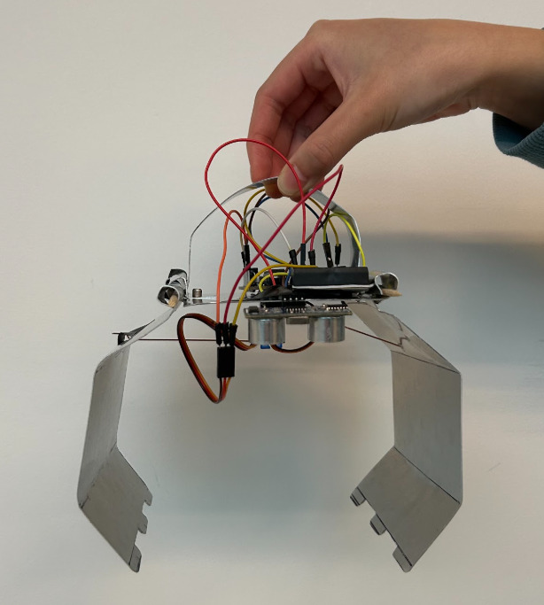

# Arduino Claw

A team-built Arduino claw combining sensors, motors, and control code.

[Portfolio overview](https://felixchen2007.github.io/projects/arduino-claw/) · [Design notes](docs/design-notes.md)

## Project details

- Contribution: Five-person team
- Tools: Arduino / Sensors / Control
- Discipline: Electromechanical design

## Documentation

The [design notes](docs/design-notes.md) contain the project write-up previously published on the portfolio website.

This repository currently contains portfolio notes and a project image. Design files, source code, and test results can be added as the documentation develops.
